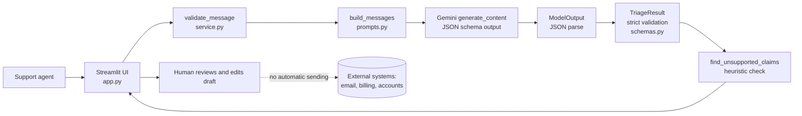

# SupportPilot: AI-Powered Customer Support Triage Copilot

SupportPilot takes a customer support message and uses the Google Gemini API to produce a **structured, validated triage analysis** for a human support agent: category, priority, summary, recommended next action, a draft reply, and an optional escalation reason.

It is a **decision-support tool**. It never sends a reply, issues a refund, changes an account, or takes any other external action. A human reviews and edits everything.

> Status: a portfolio/learning project. It has not been deployed, load-tested, or evaluated on real support data. See [Known limitations](#known-limitations).

## Problem statement

Support teams spend time reading, classifying and prioritizing incoming messages before anyone solves anything. This project explores using an LLM for that first step while keeping a human in control, and focuses on the engineering around the model: schema validation, safe error handling, prompt-injection awareness, honest outputs and testing.

## Features

- Structured analysis: category (`billing`, `technical`, `account`, `shipping`, `refund`, `other`), priority (`low`, `medium`, `high`, `urgent`), summary, recommended action, draft reply, optional escalation reason.
- Output validated with Pydantic; malformed, refused, truncated or out-of-range results are rejected, never displayed.
- Input validation (non-empty, max 2,000 characters).
- Safe, user-friendly errors for missing/invalid API key, rate limits, network failures, timeouts and bad model output. No raw API errors or stack traces in the UI.
- Reviewer warning if the draft reply contains phrases suggesting a claimed action or a promised deadline (heuristic).
- Explicit human-review notice and "no action has been taken" notice.
- Messages are not stored or logged by the app.
- 92 deterministic tests that need no API key, plus a separate live evaluation runner.

## Architecture



The dotted line is intentional: nothing in this codebase connects to external systems.

### Request-to-response workflow

1. The agent pastes a message and clicks **Analyze message**.
2. `validate_message` rejects empty or oversized input before any API call.
3. `build_messages` creates a fixed system prompt plus the message wrapped in `<customer_message>` tags (any look-alike tags inside the message are removed).
4. `service.analyze_message` calls `client.models.generate_content(...)` with `response_mime_type="application/json"` and `ModelOutput` as `response_schema`. The fixed prompt goes in `system_instruction`; the delimited message is the user content.
5. We parse the reply text into `ModelOutput` ourselves (`model_validate_json`), then re-validate into `TriageResult`, which enforces length limits. Blocked, truncated or empty replies are rejected first.
6. SDK/provider exceptions are translated into safe messages (`src/errors.py`).
7. The UI shows the result. The draft is editable. Risky phrases in the draft trigger a reviewer warning.

## Technology stack and why

| Choice | Reason |
|---|---|
| Python | Required language; broad AI ecosystem. |
| Streamlit | Fastest way to a clean, responsive UI in pure Python; easy deployment. Trade-off: reruns the script on each interaction, so state lives in `st.session_state`. |
| `google-genai` (official Google Gen AI SDK) | Official client with timeouts, retry options, typed errors and JSON-schema constrained output. `httpx` is pinned because the service catches its network exceptions directly. |
| Pydantic | One definition gives the API JSON schema and runtime validation. |
| python-dotenv | Simple local configuration without hardcoding secrets. |
| pytest | Standard, readable tests with fixtures and parametrization. |

No agent frameworks (LangChain etc.): the task is one prompt and one validated response, so extra abstraction would add weight without benefit.

## Folder structure

```
supportpilot/
├── app.py                    # Streamlit UI
├── requirements.txt          # pinned dependencies
├── pytest.ini
├── .env.example              # placeholders only
├── .gitignore
├── LICENSE
├── .streamlit/
│   ├── config.toml
│   └── secrets.toml.example
├── src/
│   ├── __init__.py
│   ├── config.py             # env-based settings
│   ├── errors.py             # exceptions with UI-safe messages
│   ├── prompts.py            # system prompt, delimiting untrusted input
│   ├── schemas.py            # Pydantic models and enums
│   └── service.py            # validation, API call, error mapping, claim check
├── scripts/
│   └── check_gemini.py       # diagnose model/key problems (live calls)
├── tests/                    # deterministic tests (no API key needed)
│   ├── conftest.py
│   ├── test_schemas.py
│   ├── test_validation.py
│   ├── test_service.py
│   ├── test_sdk_integration.py
│   ├── test_dataset.py
│   └── test_app.py
└── evals/                    # model-quality evaluation (live API, opt-in)
    ├── dataset.json
    └── run_evaluation.py
```

## Prerequisites

- Python 3.11 or newer (development and tests were run on Python 3.13).
- A Gemini API key from [Google AI Studio](https://aistudio.google.com/apikey). Check Google's current pricing and free-tier limits yourself; I did not verify them. pytest makes no API calls.
- Git, if you want to publish to GitHub.

## Local installation

**macOS / Linux**

```bash
cd supportpilot
python3 -m venv .venv
source .venv/bin/activate
pip install -r requirements.txt
cp .env.example .env
```

**Windows (PowerShell)**

```powershell
cd supportpilot
py -m venv .venv
.venv\Scripts\Activate.ps1
pip install -r requirements.txt
Copy-Item .env.example .env
```

If PowerShell blocks activation: `Set-ExecutionPolicy -Scope CurrentUser RemoteSigned`.

### Environment variables

Edit `.env`:

| Variable | Required | Default | Meaning |
|---|---|---|---|
| `GEMINI_API_KEY` | yes | none | Your Gemini API key. Never commit `.env`. |
| `SUPPORTPILOT_MODEL` | no | `gemini-3.8-flash` | Must support JSON/structured output. This default is the model used in Google's structured-output docs when this project was written; model names change often, so check Google's current model list. |
| `SUPPORTPILOT_TIMEOUT_SECONDS` | no | `30` | Request timeout, 1-120. |

## Check your Gemini setup (optional)

If the app reports that the model or request was rejected, run:

```bash
python scripts/check_gemini.py            # lists models on your key and tests the configured one
python scripts/check_gemini.py MODEL_NAME # tests a specific model
```

It makes a few tiny real API calls and prints Gemini's own error text (key redacted).

## Run the app

```bash
streamlit run app.py
```

Open the URL Streamlit prints (usually http://localhost:8501).

## Run the tests

```bash
python -m pytest
```

These tests use fakes and an in-process fake HTTP transport. They need no API key and make no network calls. They verify **our code's behaviour**, not model quality.

## Run the model evaluation

The evaluation is separate from the tests because it calls the real model.

```bash
python evals/run_evaluation.py --dry-run          # validate the dataset only, free
python evals/run_evaluation.py --live --limit 3   # small, cheap trial run
python evals/run_evaluation.py --live --output evals/results/run1.json
```

`evals/dataset.json` has 15 fictional messages covering all categories and priorities, ambiguous and multi-issue messages, missing details, a legal threat, a data-deletion request, and adversarial/injection attempts. Each has acceptable labels (several cases accept more than one, because triage is partly subjective).

The runner prints observed category/priority/escalation matches, claim warnings and latency **for that one run**. LLM output varies from run to run, and 15 cases cannot support general accuracy claims. Read the draft replies yourself. This repository does not include evaluation results; run it yourself and report what you observe.

## Example (illustrative only, not a measured result)

Input:

> I was charged twice for my order, and nobody has responded to my refund request.

A plausible output, written by hand to show the format:

| Field | Example value |
|---|---|
| Category | billing |
| Priority | high |
| Summary | Customer reports a duplicate charge and an unanswered refund request. |
| Recommended action | Ask for the order number and both charge dates, then review billing records for the duplicate charge. |
| Draft reply | "I'm sorry about the double charge and the lack of response. Could you share your order number and the dates of the two charges so we can look into it?" |
| Escalation | none |

Real outputs will differ.

## Privacy and security

- **Third-party processing:** the message text is sent to the Google Gemini API. Check Google's current terms on data use and retention for your key type (for example, free versus paid usage may be treated differently) before using any real customer data. This project is intended for fictional or properly redacted data.
- **No persistence:** the app stores nothing. The message exists in memory for the browser session (Streamlit session state) and is not written to disk or logs. Logging records only error types and status codes.
- **Secrets:** read from environment variables; `.env` and `.streamlit/secrets.toml` are git-ignored; settings print the key as `***`.
- **Prompt injection:** the system prompt instructs the model to treat the message as untrusted data and ignore embedded instructions, and the message is delimited with tags (look-alike tags are stripped). **Prompt instructions alone cannot guarantee protection.** The more important defence is architectural: model output is only displayed to a human, with no tools or side effects attached. The worst realistic outcome is a misleading draft, which is why human review is mandatory.
- **Honesty:** the prompt forbids inventing order details, policies, outcomes or deadlines, and a regex check flags drafts that appear to claim actions or promise timeframes. This is a heuristic with false positives and false negatives.
- **Deployment privacy:** a public deployment lets anyone use your API key's quota and send data through your account. See [Deployment](#deployment).

## Known limitations

- Triage quality has not been measured. Priority and category are model judgments and can be wrong.
- English only. Non-English messages were not tested.
- The model has no access to orders, policies or customer history, so it can only ask for information, not verify it.
- The claim detector is a short regex list and will miss paraphrases.
- No authentication, rate limiting or spend cap in the app itself.
- Single message at a time; no conversation history, batch mode, or ticketing integration.
- Dependency versions were validated only on Python 3.13. The `google-genai` SDK changes quickly; if you change versions, re-run the tests.
- The code has not been run against the live Gemini API. The request shape is tested against a fake HTTP transport, but real-world behaviour (for example, how the chosen model handles the schema) is unverified.
- Deployment has not been performed or verified.

## Deployment

This is a standard Streamlit app, so **Streamlit Community Cloud** is a straightforward option (alternatives: Hugging Face Spaces, Render, a container on any host).

1. Push the repository to GitHub (see below).
2. In Streamlit Community Cloud, create an app from the repository with main file `app.py`.
3. Open the app's **Settings → Secrets** and add:
   ```toml
   GEMINI_API_KEY = "your-real-key"
   ```
   Per Streamlit's documentation, top-level secrets are also exposed as environment variables, which is what `src/config.py` reads. Verify this on first deploy by checking the app does not report a missing key.
4. Before sharing the URL: set quota/budget limits for your Google Cloud project, use a dedicated key, and consider restricting app access to specific viewers. A public URL with no authentication means strangers can spend your budget and see how the app behaves.

## Publish to GitHub

```bash
git init
git add .
git status          # confirm .env and .venv are NOT listed
git commit -m "Initial commit: SupportPilot"
git branch -M main
# Create an empty repository named "supportpilot" on github.com first (no README/license), then:
git remote add origin https://github.com/<your-username>/supportpilot.git
git push -u origin main
```

Never commit a real key. If you accidentally do, revoke the key immediately; deleting the commit is not enough.

## Future improvements

- Authentication and per-user rate limits for hosted use.
- Retrieval over a real knowledge base so replies can cite actual policies.
- Larger, human-labelled evaluation set; track results across prompt/model changes.
- Redaction of personal data (emails, card numbers) before the API call.
- Multilingual support; confidence signals; reviewer feedback capture.
- Structured logging with redaction; cost tracking.

## Interview talking points and trade-offs

- **Why two Pydantic models?** `ModelOutput` is the schema given to the API (types and enums only; Gemini supports only a subset of JSON Schema). `TriageResult` is the application contract with length limits. This avoids depending on provider support for every JSON-schema keyword, and still guarantees nothing unvalidated reaches the UI.
- **Why schema-constrained output instead of "reply in JSON"?** The API constrains generation to the schema, which reduces parsing failures. It does not guarantee *semantic* correctness, so I still parse and validate the text myself and keep human review.
- **Why a generous `max_output_tokens`?** Gemini "thinking" models count reasoning tokens against the limit, so a small cap can truncate the JSON. Truncation is detected and rejected.
- **Prompt injection:** I can explain why delimiting and instructions are mitigations, not guarantees, and why the real control is that the model has no capabilities beyond producing text for a human.
- **Honest outputs:** missing information should lead to a question, not a guess. The prompt rule is backed by a deterministic regex check that surfaces risky drafts, and I can discuss its limits.
- **Testing strategy:** deterministic tests (schemas, validation, error mapping, fake HTTP transport for the real SDK path, UI via Streamlit `AppTest`) versus a separate, opt-in model evaluation. The first proves the code works; only the second says anything about the model, and even then only for that run.
- **Error handling:** SDK exceptions are mapped to safe messages; raw provider text can contain sensitive details, so it is never shown or logged.
- **Cost/latency choices:** a small model, bounded output tokens, a timeout and limited SDK retries. I have not measured actual cost or latency.
- **What I would do next:** a larger labelled dataset, PII redaction, authentication, and a measured comparison of models.

## License

MIT. See [LICENSE](LICENSE).
